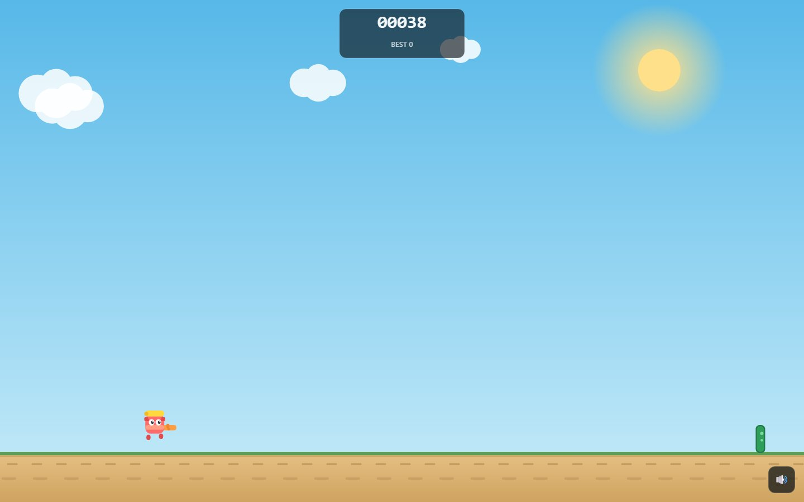

<div align="center">

# 🏃 Sprint: Endless Runner

**A fast, lightweight endless runner built with vanilla HTML, CSS and JavaScript.**


</div>

---

## ✨ Why Sprint?

It is an endless runner that fits in three files. Jump over cacti, rocks and birds, survive as the game accelerates, and try to beat your best distance. Everything is drawn on a canvas that adapts to the browser window, and the whole thing runs without frameworks, packages or a build step.

The small size does not mean it is shallow: variable-height jumps, a double jump, increasing difficulty, sound effects that respect autoplay rules, and a best score that persists in `localStorage`. It is a compact demonstration of a game loop, physics and input handling done by hand.

### 🧩 What's inside

- 🎮 **Canvas gameplay** that adapts to the browser window.
- 🦘 **Single and double jumps**, with variable height — release early for a shorter hop.
- ⌨️ **Keyboard and touch controls** on the same code path.
- 📈 **Increasing speed and difficulty** the longer you survive.
- 🌵 **Cacti, double cacti, rocks and flying birds.**
- 🏆 **Best score** saved in `localStorage`.
- 🔊 **Jump, landing, double-jump and game-over sounds**, with a persistent mute setting.
- 🪶 **No frameworks, dependencies or build step.**

---

## 📸 Screenshots



---

## 🎛 Controls

| Action | Keyboard | Touch |
| --- | --- | --- |
| Jump | `Space`, `W` or `ArrowUp` | Tap the screen |
| Double jump | Press the jump control again while airborne | Tap again while airborne |
| Toggle sound | `M` | Tap the speaker button |

---

## 🚀 Run locally

No installation is required. Open `index.html` in a modern web browser.

For a local development server:

```bash
npx serve .
```

Then open the local URL printed by the command.

---

## 🗂 Project structure

```text
runner/
├── index.html   # Game shell and interface elements
├── style.css    # Layout and menu styling
├── game.js      # Game loop, physics, rendering, input and audio
└── README.md
```

---

## 📈 How scoring works

Your score increases with distance travelled. The best score is stored locally in the browser, so it stays available between sessions on the same device and browser.

---

## 🌐 Browser support

Use a current version of Chrome, Edge, Firefox or Safari. Audio is initialized after the first user interaction to comply with browser autoplay rules.

---

## 🗺 Roadmap ideas

- 👾 More obstacle types and patterns
- 🛒 Power-ups with short-lived effects
- 🎚️ Difficulty selector
- 📱 On-screen touch controls for the double jump

---

<div align="center">

No dependencies, no build step — just a canvas and a game loop.

</div>
